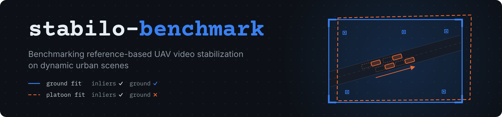
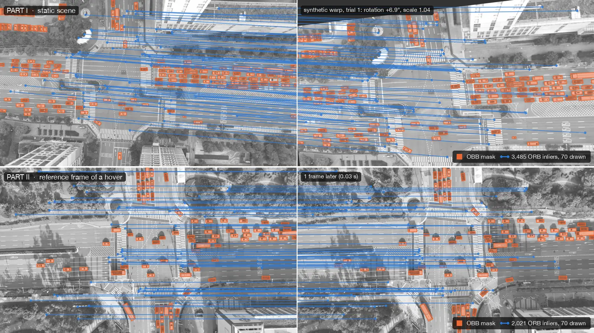
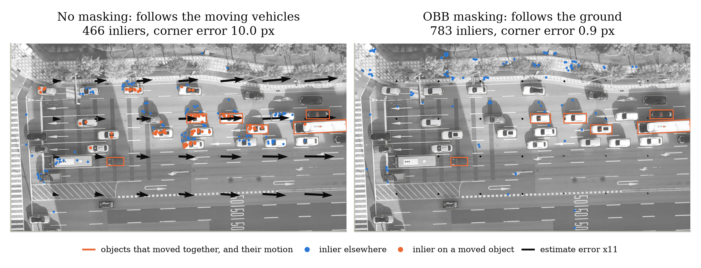
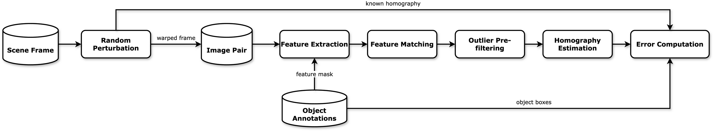
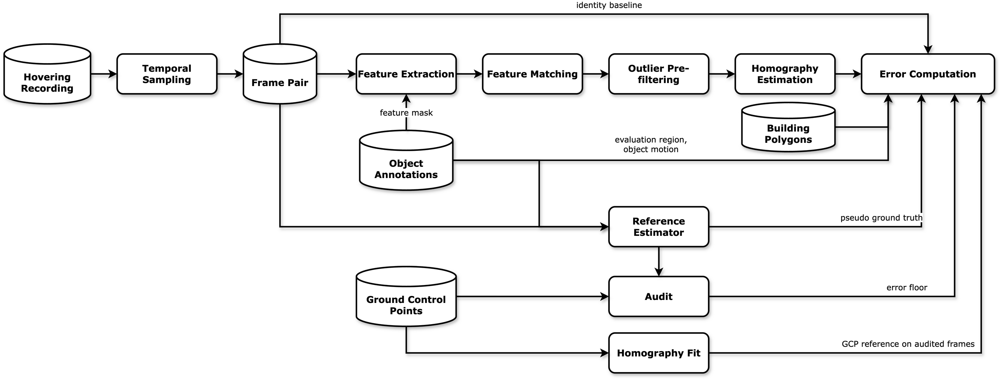
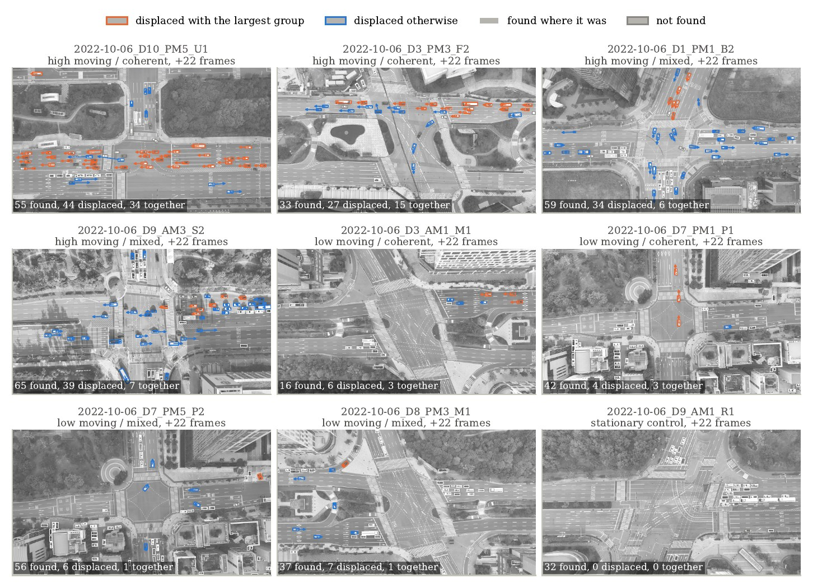

[](https://github.com/rfonod/stabilo-benchmark/releases) [](https://pypi.org/project/stabilo-benchmark/) [](https://pepy.tech/project/stabilo-benchmark) [](https://github.com/rfonod/stabilo-benchmark/actions/workflows/ci.yml) [](https://www.python.org/) [](https://github.com/rfonod/stabilo-benchmark/blob/main/LICENSE) [](https://github.com/rfonod/stabilo-benchmark/issues) [](https://arxiv.org/abs/2611.17190) [](https://doi.org/10.5281/zenodo.24168255) [](https://doi.org/10.5281/zenodo.23623540)

**Stabilo Benchmark** evaluates the complete registration pipeline of reference-based UAV video
stabilization (feature detector, descriptor, matcher, robust estimator and object masking) on
static and dynamic urban scenes. It is the benchmark of the paper **["Consensus Capture in
Reference-Based UAV Video Stabilization: A Benchmark on Dynamic Urban Scenes"](https://arxiv.org/abs/2611.17190)**: the protocols, the
metrics and the commands that regenerate every benchmark table and figure from the paper's
[data record](#the-songdo-experiment). Pipelines are run through [Stabilo](https://github.com/rfonod/stabilo) ⚖️,
and objects are annotated with [HBB2OBB](https://github.com/rfonod/hbb2obb) 🔄.



🎬 Both protocols on the Songdo data, one step per trial and per temporal offset. **Top, Part I:** a
static 4K scene against a synthetic warp of itself, whose homography is known exactly. **Bottom,
Part II:** a hover's reference frame against later frames of the same hover, from one frame to a
minute and a half later. Blue lines are a sample of ORB's inlier matches, orange the oriented-box
masks that keep the vehicles out of feature detection.

### Why Stabilo Benchmark

- 🚗 **Built for scenes that move.** Feature-matching benchmarks score correspondences on scenes in
  which only the camera moves. Over an intersection, vehicles moving together supply mutually
  consistent correspondences that can draw the homography toward their own motion:
  [consensus capture](#consensus-capture).
- 🎯 **Scored on the ground, never on the inliers.** Pipelines are ranked by how well they align
  the static world: against exact homographies in Part I, against an audited reference estimator
  and by the background's photometric alignment in Part II. Inlier statistics are diagnostics only.
- 🧭 **Capture made observable.** The registration error is decomposed along the dominant motion
  axis of the annotated objects, and a capture fraction measures how far an estimate follows the
  largest group of objects that moved together.
- 📍 **An audited reference.** Part II's pseudo-ground truth is checked against manually annotated
  ground control points, which also score every candidate directly.
- 🎭 **Masking as a controlled axis.** No masking, horizontal boxes (HBB) and oriented boxes (OBB),
  applied before feature detection to every pipeline alike.
- ⚖️ **Pipelines on equal footing.** Paired trials, per-pipeline tuning on a site-disjoint split, a
  matched resolution and feature budget, failures counted rather than dropped, and a pre-specified
  analysis plan (cluster bootstrap with an equivalence margin set by the audit).
- 📦 **Every number from a command.** The data record holds the inputs and every campaign's
  results; `fetch` downloads it and `report` regenerates the tables and figures.

## Consensus Capture



🔍 One pair of a Songdo hover, a third of a second apart, registered by ORB at the real-time budget.
Without masking (left), the estimate registers the platoon in the middle of the crop back onto where
it stood: many of its inliers lie on the vehicles that moved (orange dots), and its error, drawn as
black arrows magnified 11 times, carries their motion across the crop. Under oriented-box masks
(right), the same pipeline finds its inliers on the ground and aligns it.

A homography that describes the moving foreground is as self-consistent as one that describes the
camera, so the statistics a robust estimator reports cannot tell the two apart:

| | inliers | inlier ratio | reprojection error | static-world alignment |
| --- | --- | --- | --- | --- |
| homography describing the **camera** motion | healthy | healthy | low | **good** |
| homography describing the **moving foreground's** motion | healthy | healthy | low | **poor** |

The benchmark therefore measures alignment from outside the estimator. It applies to any footage in
which annotated objects move independently of the camera; vehicles at intersections are the paper's
application.

## Benchmark Design

**Part I: static protocol.** Each scene is warped by a random homography with photometric
degradation (brightness, saturation, blur, haze, sensor noise, JPEG compression), and every
pipeline recovers it. The ground truth is exact, so the protocol establishes what each pipeline can
do when nothing moves, which of its settings matter, and what masking costs. Every pipeline is
tuned on scenes from sites disjoint from the evaluation scenes, at a resolution and feature budget
matched across pipelines, and faces the same perturbations in each trial.



**Part II: dynamic protocol.** Real hovers are registered frame by frame onto one reference frame,
over temporal offsets from one frame to two minutes. The cases and their reference frames are chosen
from the video alone to span how much of the foreground
moves and how coherently, with a stationary control. Real footage has no true homography: a reference estimator
supplies a pseudo-ground truth whose error is measured against ground control points, and the
reference-free measures score the background only, outside every object and outside above-ground
structure. Every pipeline runs at two points of Part I's budget grid: **offline** (half resolution,
2000 features, for registration after the flight) and **real-time** (the grid's cheapest point,
for registration at video rate).



**Pipelines.** Ten detector and matcher combinations of Stabilo, each with its own tuned matcher
and estimator thresholds: ORB, SIFT, RootSIFT, BRISK, AKAZE, XFeat, DISK, DeDoDe and KeyNet (the
last three with LightGlue), and the detector-free LoFTR. The robust estimator is a further axis of
Part I. Named presets are in [`stabilo_benchmark/cfg/pipelines.yaml`](stabilo_benchmark/cfg/pipelines.yaml);
any Stabilo configuration can be benchmarked.

**Metrics.**

| Family | Metrics | Needs |
| --- | --- | --- |
| Geometric | corner transfer error (CTE), homography estimation accuracy (HEA) at pixel thresholds, mAA (area under the HEA curve, the ranking quantity) | a true or reference homography |
| Object-level | IoU and object center error (OCE) of each annotated box after registration, per frame: mean, std, min, q1, median, q3, max | the same, plus boxes |
| Photometric | SSIM, ZNCC, mutual information, gradient orientation similarity over the static background | the two frames |
| Capture | error along and across the dominant motion axis, capture fraction, share of inliers on objects that moved | Part II's object motion |
| Diagnostic | keypoints, matches, inliers, inlier ratio | never used for ranking |

Object boxes are carried corner by corner through the homography and compared as quadrilaterals.
OCE is the position error a trajectory inherits from registration; unlike IoU, it does not depend
on object size.

## Install

It is recommended to work from a clone, which holds the paper's configs, scripts and the sample
data (Python 3.11 to 3.13):

```bash
git clone https://github.com/rfonod/stabilo-benchmark.git
cd stabilo-benchmark
python3.11 -m venv .venv && source .venv/bin/activate  # Windows: .venv\Scripts\activate
pip install -e .
```

[HBB2OBB](https://github.com/rfonod/hbb2obb), which writes the object annotations, is installed with
it. `pip install stabilo-benchmark` installs the package and its command alone, to run your own
configs on your own data.

<details>
<summary><b>Alternatives: uv or conda, development install</b></summary>

```bash
uv venv --python 3.11 && source .venv/bin/activate && uv pip install -e .   # uv
conda create -n stabilo-benchmark python=3.11 -y && conda activate stabilo-benchmark && pip install -e .
pip install -e '.[dev]'                                                      # adds pytest and ruff
```

</details>

> [!IMPORTANT]
> **OpenCV must stay 4.x.** OpenCV 5.0 removed the Python bindings of BRISK, KAZE and AKAZE.
> `opencv-python<5.0` is a declared dependency, but `opencv-python-headless`,
> `opencv-contrib-python` and the contrib headless build install the same `cv2` package, and the
> last one installed wins. Every command that runs a pipeline checks the bindings first and names
> the distribution to reinstall; `STABILO_BENCHMARK_ALLOW_OPENCV5=1` turns the refusal into a
> warning for grids that use none of the three. To check:
>
> ```bash
> python -c "import cv2; print(cv2.__version__, hasattr(cv2, 'AKAZE_create'))"   # want 4.x.y True
> ```
>
> Prefer uninstalling a stray headless build over pinning it below 5.0: it has no GUI, and
> `annotate-gcp` opens a window.

## Quick Start

[`data/sample/`](data/sample/) holds a subset of the paper's data record, so every command runs
from a fresh clone without a download, video, GPU or detector weights. **Part I**, three of the
paper's 29 static scenes, those with the fewest, the median and the most vehicles:

```bash
stabilo-benchmark static configs/sample/static.yaml -v 1
```

```
Static benchmark 'smoke': 6 pipeline(s) x 3 scene(s) x 5 trial(s) = 90 evaluations
  orb+none      median CTE  0.129 px | failure rate 0.0% | n=15
  orb+hbb       median CTE  0.155 px | failure rate 0.0% | n=15
  ...
  sift+obb      median CTE  0.070 px | failure rate 0.0% | n=15
```

**Part II**, ten frames of one of the paper's cases, a hover over an intersection, with their
labels, ground control points and exclusion polygons, in the protocol's order: the reference
estimator is audited before any candidate is scored.

```bash
case=data/sample/dynamic/2022-10-06_D9_AM3_S2
stabilo-benchmark oracle  $case -c configs/sample/dynamic.yaml
stabilo-benchmark audit   $case
stabilo-benchmark dynamic $case -c configs/sample/dynamic.yaml -v 1
stabilo-benchmark audit   $case --results $case/results/smoke
```

```
Reference estimator audit against ground control points
  ...
  pooled over 117 point(s): median 0.12 px, p95 0.45 px, max 1.01 px
  ...
Dynamic benchmark 'smoke': 6 pipeline(s) x 9 frame pair(s) = 54 registrations, plus the identity and reference baselines
  orb+none      median CTE 0.81 px | SSIM 0.914 | align 0.61 | inlier ratio 0.57 | failures 0.0%
  orb+hbb       median CTE 0.40 px | SSIM 0.935 | align 0.61 | inlier ratio 0.78 | failures 0.0%
  orb+obb       median CTE 0.40 px | SSIM 0.935 | align 0.59 | inlier ratio 0.78 | failures 0.0%
  ...
```

Then the LaTeX tables and PDF figures, into `reports/` unless `--output` says otherwise:

```bash
stabilo-benchmark report data/sample/static/results/smoke
stabilo-benchmark report $case/results/smoke
```

Results land in `results/smoke/` inside each part. The sample is a smoke test, never evidence:
three scenes and nine frame pairs are too few to rank pipelines.
[`data/sample/README.md`](data/sample/README.md) describes where each file comes from and how to
try the annotation tools on it.

<details>
<summary><b>📋 Full Feature Overview</b></summary>

- **Static benchmark** (`static`): random homographies (translation, rotation, scale, projective)
  and a photometric chain (brightness, contrast, saturation, blur, haze, Gaussian and shot noise,
  JPEG), drawn per scene and trial independently of the pipeline, so every pipeline faces the same
  perturbations. Perturbed frames are cached on disk during a campaign.
- **Case selection** (`survey`): reads every candidate reference frame of a set of recordings as the
  benchmark will, finds where each object went by appearance after removing the platform's motion,
  and fills a 2×2 design on moving foreground × coherence plus stationary controls, before any
  benchmark runs. Thresholds are in object widths, not pixels.
- **Case preparation** (`prepare`): extracts a hover's sampled frames, by the config's sampling plan
  (the paper's: twelve octave-wide offset bins), from a video or from frames already extracted.
- **Reference estimator** (`oracle`) and its **audit** (`annotate-gcp`, `audit`): ground control
  points placed by hand in the reference frame and, in later frames, from proposals of a local image
  fit to accept or correct; the audit's 95th percentile becomes the equivalence margin.
- **Dynamic benchmark** (`dynamic`): reference-free background alignment over an evaluation region
  that excludes every object, a constant margin around it and hand-drawn above-ground structure;
  object-level errors and capture measures against the reference estimator.
- **Masking**: none, HBB and OBB, with a safety margin, applied before feature detection. The
  evaluation region is computed separately and never depends on the pipeline's own masks.
- **Tuning** (`static`, `dynamic`): a joint grid over the matcher's ratio and the estimator's
  inlier threshold on sites held out from evaluation; `report` selects each pipeline's values by a
  fixed incumbent rule.
- **Statistics**: cluster bootstrap over scenes or cases, an equivalence margin from the audit, and
  bolding of every value not distinguishable from the best.
- **Reports** (`report`): LaTeX tables, CSV files and PDF figures from stored results, pooling
  several cases with equal weight.
- **Bookkeeping**: a manifest per campaign (config and hash, grid, versions, hardware, seeds),
  resumable campaigns, runs ordered cheapest first, out-of-memory runs recorded as infeasible.

</details>

<details>
<summary><b>🔗 Related Projects</b></summary>

- **[Stabilo](https://github.com/rfonod/stabilo) ⚖️**: video and trajectory stabilization against a
  reference frame, with user-defined masks. The registration engine every benchmarked pipeline runs
  through.
- **[HBB2OBB](https://github.com/rfonod/hbb2obb) 🔄**: detects horizontal boxes and converts them to
  oriented boxes with SAM-family models. Writes the annotations behind the masking axis.
- **[Geo-trax](https://github.com/rfonod/geo-trax) 🚀**: georeferenced vehicle trajectory extraction
  from drone video, whose stabilization stage motivates this benchmark. Supplies the default
  detector.
- **[Stabilo-Optimize](https://github.com/rfonod/stabilo-optimize) 🎛️**: the ground-truth-free static
  campaign of the background paper, which Part I extends.

</details>

## Usage

| Command | What it does |
| --- | --- |
| `fetch <dataset>` | Download a dataset listed in `data/registry.yaml` from Zenodo, verify and extract it |
| `survey <recordings> -c <config>` | Choose which hovers become Part II cases, and their reference frames, before any benchmark runs |
| `static <config>` | Part I: benchmark under known synthetic homographies (results in `<scenes>/results/`) |
| `prepare <video>` | Build a dynamic case: extract the sampled frames into `<case>/images` |
| `prepare --from-frames <dir>` | Same, from frames already extracted (no video or decoder); `--frames` adopts a subset |
| `oracle <case>` | Cache the reference estimator's homographies for every frame pair |
| `annotate-gcp <case>` | Place ground control points in a magnified panel: by hand in the reference frame, from proposals to accept or correct in later frames |
| `audit <case>` | Bound the reference estimator's error against those points |
| `dynamic <case> -c <config>` | Part II: benchmark on real footage (results in `<case>/results/`) |
| `report <results> [<results> ...]` | LaTeX tables and PDF figures; several dynamic directories pool the cases with equal weight |

`static` and `dynamic` take `--results-dir <dir>` to write the campaign to `<dir>/<name>`, `-o` to
overwrite and `-r` to resume. `stabilo-benchmark <command> -h` lists every flag;
`python -m stabilo_benchmark` is equivalent.

### Static campaign

```bash
# 1. Annotate <scenes>/images with hbb2obb (see "Annotating images")

# 2. Tune each pipeline on scenes held out from the evaluation set
stabilo-benchmark static configs/songdo/static/tuning.yaml --scenes <scenes> \
    --scenes-list <tuning_scenes.txt> -v 1

# 3. Score the tuned pipelines on the evaluation scenes, then build the tables and figures
stabilo-benchmark static configs/songdo/static/detectors.yaml --scenes <scenes> \
    --scenes-list <eval_scenes.txt> -v 1
stabilo-benchmark report <scenes>/results/detectors --kind static --output <out>
```

`--scenes-list` restricts a scenes directory to the names in a text file (one per line), which
keeps the tuning and evaluation scenes disjoint. [`docs/songdo_static.md`](docs/songdo_static.md)
describes the paper's campaigns, with its scene split in `configs/songdo/static/`.

### Dynamic campaign

```bash
# 0. Choose which hovers become cases, and their reference frames, from the recordings alone
stabilo-benchmark survey <videos>/*.mp4 -c configs/songdo/dynamic/offline_masking.yaml \
    --anchor scan --max-per-video 1 -k 2 --controls 1

# 1. Build a case at the reference frame the survey chose, then annotate <case>/images with
#    hbb2obb. --cell records the survey cell of this segment.
stabilo-benchmark prepare <videos>/intersection_a.mp4 -o <cases>/intersection_a \
    -c configs/songdo/dynamic/offline_masking.yaml --reference 1800 --cell "high moving / coherent"

# 2. Cache the reference estimator's homographies
stabilo-benchmark oracle <cases>/intersection_a -c configs/songdo/dynamic/offline_masking.yaml

# 3. Outline above-ground structure (buildings) on the reference frame, in LabelMe; the config's
#    metrics.region.exclusion leaves it out of the evaluation region (null excludes nothing)
./scripts/draw_exclusion.sh <cases>/intersection_a

# 4. Place ground control points: by hand in the reference frame; in later frames each opens on a
#    proposal (a local image fit, independent of the reference estimator) that Enter accepts and a
#    click corrects (--no-propose places every point by hand; --repeat is a second, unaided session;
#    --labels re-places single points in the given frames), then audit
stabilo-benchmark annotate-gcp <cases>/intersection_a
stabilo-benchmark annotate-gcp <cases>/intersection_a --frames 0 --labels p02
stabilo-benchmark annotate-gcp <cases>/intersection_a --repeat
stabilo-benchmark audit <cases>/intersection_a

# 5. Benchmark, score the candidates against the ground control points, and report
stabilo-benchmark dynamic <cases>/intersection_a -c configs/songdo/dynamic/offline_masking.yaml -v 1
stabilo-benchmark audit <cases>/intersection_a --results <cases>/intersection_a/results/offline_masking
stabilo-benchmark report <cases>/intersection_a/results/offline_masking <cases>/intersection_b/results/offline_masking
```

**`audit` precedes `dynamic`**, so the reference estimator's error is measured before any
candidate number is read. Its 95th percentile is the margin below which differences between
candidates are not interpreted; `report` states it with every Part II table.
[`docs/songdo_dynamic.md`](docs/songdo_dynamic.md) is the full recipe of the paper's cases.

<details>
<summary><b>🧭 Choosing cases with <code>survey</code></b></summary>

`survey` reads each candidate reference frame the way the benchmark will, as pairs of that frame
with one later frame per survey bin (offsets of 1 to 22 frames in the shipped configs), and asks
where its objects went: found where they were (`static`), found displaced (`moving`), displaced
together with the largest group (`coher.`, as a share of `moving`), or gone. It fills a 2×2 on
moving foreground × coherence plus stationary controls:

```
Read 831 segment(s) across 370 recording(s)
Splits (pool median): moving 0.675% of the frame, coherence 0.422; controls: stationarity >= 0.902 and static >= 1.408%

segment            cover%  static  moving  coher.  still  texture  margin  cell
-------------------------------------------------------------------------------
D10_PM5_U1@001170    3.00    0.66    1.94    0.80   0.25     3606    4.21  high moving / coherent
D9_AM3_S2@000300     3.96    1.76    1.89    0.22   0.48     4990    2.23  high moving / mixed
D7_PM1_P1@000300     1.81    1.53    0.17    0.74   0.90     4757    1.94  low moving / coherent
D7_PM5_P2@001200     2.35    1.95    0.24    0.23   0.89     3936    1.66  low moving / mixed
D9_AM1_R1@002100     2.02    1.94    0.00       -   1.00     4068    0.52  stationary control
...
Design:
  high moving / coherent   2/2  ok  (pool: 173)
  high moving / mixed      2/2  ok  (pool: 179)
  low moving / coherent    2/2  ok  (pool: 179)
  low moving / mixed       2/2  ok  (pool: 172)
  stationary control       1/1  ok  (pool: 56)
  72 candidate(s) unclassified: too few displaced objects for coherence
```

The platform's motion is removed by an affine fit to the background, and objects are found again
by appearance among the detections, so nothing is tracked through the recording and six annotated
frames per candidate suffice. Thresholds are in object widths, independent of the ground
resolution. A cell that cannot be filled is reported as `SHORT`, never filled from a neighboring
cell. With `--anchor scan` the survey reads every recording at points 30 s apart; `-c` keeps only
reference frames with enough recording after them for the config's sampling plan, and
`--group-pattern` keeps a cell from taking two hovers of one site.

</details>

<details>
<summary><b>📏 The evaluation region and its margin</b></summary>

The reference-free measures skip every object and a constant margin around it,
`metrics.region.mask_dilation_px` (10 px in the shipped configs, set for 4K frames). The margin is
in pixels because what it absorbs is: the reference estimator's error and the blur of object edges
under the warp, not the object's size. Scale it with the frame and keep it above the audited
equivalence margin; `report` warns when the margin reaches it. The above-ground polygons drawn in
step 3 are removed from the region as well, and their SHA-256 is recorded in the manifest.

</details>

### Annotating images

Object boxes drive the masking axis, so annotate your frames. Part I scenes and Part II cases share
one layout:

```
<root>/
  images/              the frames
  labels_hbb/          horizontal object boxes      -> masking: hbb
  labels_obb/          oriented object boxes        -> masking: obb, and for every mode the metric regions and IoU/OCE
  labels_confidence/   per-box conversion score
  PROVENANCE_hbb.txt   PROVENANCE_obb.txt
```

[HBB2OBB](https://github.com/rfonod/hbb2obb) provides two commands. `hbb2obb-detect` writes the
horizontal boxes, by default with the [Geo-trax](https://github.com/rfonod/geo-trax) vehicle
detector for high-altitude drone imagery (car, bus, truck, motorcycle). `hbb2obb` then prompts SAM
with each horizontal box and writes its oriented box, in the same order. The settings the benchmark
uses:

```bash
hbb2obb-detect <root>/images --model geotrax --no_confidence --save_provenance
hbb2obb <root>/images --sam_models sam_l --imgsz 1024 --scale_factors 0.02 --opening_kernel_percentage -0.1 --fragment_ratio 0.1 --confidence_dir --save_provenance
```

- Add `--device 0` (or `cpu`, `mps`) to either command.
- Checkpoints download into `models/` under the working directory unless `HBB2OBB_MODELS_DIR` or
  `--models_dir` points elsewhere.
- Run both commands from the directory holding `<root>`, with relative paths: hbb2obb writes the
  command and its paths into the provenance files as typed.
- Where SAM finds no usable mask, hbb2obb keeps the horizontal box and scores it 0.0 in
  `labels_confidence/`.

The benchmarks read these labels and never run a model themselves (only `survey` calls the two
commands above), so every pipeline receives identical masks.

<details>
<summary><b>🏷️ Other objects, another detector, or no annotations</b></summary>

`--model` also takes a local `.pt` file, a Hugging Face file, a link to a checkpoint or an
Ultralytics model name, and `--class_map` renumbers its classes (see HBB2OBB's
[detection guide](https://rfonod.github.io/hbb2obb/guides/detect/)). Horizontal boxes you already
have, as YOLO text files in `<root>/labels_hbb/`, need only the second command. Any object class
works, given boxes for it. `motion_alignment` assumes a dominant direction of motion and is not
reported when the objects' orientations are too spread out.

A `<root>` with neither `labels_hbb/` nor `labels_obb/` is unannotated: `static`, `oracle` and
`dynamic` refuse any masking mode other than `none` on it, the manifest records `annotated: false`,
and `report` warns. Select masking `none` with `--set`:

```bash
stabilo-benchmark static configs/sample/static.yaml --scenes <scenes> --set pipeline.masking=none
stabilo-benchmark oracle <case> -c <config> --set oracle.masking=none
stabilo-benchmark dynamic <case> -c <config> --set pipeline.masking=none --set oracle.masking=none
```

What is lost: the masking comparison, IoU and OCE, and the motion axis; in Part II the evaluation
region no longer excludes objects, so the photometric scores include whatever moves.

</details>

### Configuration

Experiments are YAML files (JSON also loads). Every quantity that shapes a reported number is a
config key, so a result is reproducible from its manifest:

```yaml
kind: static
seed: 0
trials: 100

perturbation:
  geometric: { translation_ratio: 0.10, rotation_deg: 15.0, scale_ratio: 0.05, projective: 5.0e-5 }
  photometric:
    - { name: brightness, range: [0.75, 1.25] }
    - { name: noise, max_sigma: 3.0 }
    - { name: jpeg, quality: [70, 95] }

pipeline: # the Cartesian product of these lists becomes the run grid
  preset: [orb, sift, rsift, xfeat, disk_lightglue, loftr]
  masking: [none, hbb, obb]
```

`--set key.path=value` overrides any existing key, so a one-parameter sweep needs no file per point:

```bash
for deg in 0 15 30 45 60 90; do
  stabilo-benchmark static configs/songdo/static/rotation_sweep.yaml --scenes <scenes> \
    --set perturbation.geometric.rotation_deg="[$deg,$deg]" --name "rotation_${deg}deg" -o
done
```

IoU and OCE are computed on the oriented boxes for every run, whatever its masking strategy. To use
the horizontal boxes, set `metrics.object_boxes: hbb`; `report` then labels the headers
IoU<sub>HBB</sub> and OCE<sub>HBB</sub> and refuses to mix the two settings. The paper's campaigns
are in [`configs/songdo/`](configs/songdo/).

<details>
<summary><b>🔁 Reproducibility</b></summary>

- Every result directory has a `MANIFEST.json` (config and its hash, run grid, package versions
  including this package's, hardware, seeds), one JSON file per run, and a `SUCCESS.txt`,
  `WARNING.txt` or `FAILURE.txt` marker. `audit --results` adds `GCP_SCORES.json`, the campaign's
  candidates scored against the ground control points; writing runs into the directory removes it.
- `--resume` validates the stored grid against the config and skips completed runs; delete a run's
  file and resume to redo it. Run one campaign per process.
- A run that runs out of memory is recorded as `infeasible` and reported as N/A; its partial
  measurements are discarded. Runs are ordered cheapest first.
- numpy, OpenCV and torch are seeded separately. A repeat with the same seed reproduces every metric
  bit for bit, except wall-clock timings and `USAC_PARALLEL`, whose thread scheduling moves corners
  by about 0.0015 px at 4K.
- Static campaigns cache each perturbed frame in `<results-dir>/.cache/` and delete the cache when
  the campaign completes (about 25 MB per 4K frame and trial). Disable it with `--no-trial-cache`.
- Annotations are not bit-reproducible: detector and SAM outputs depend on package versions,
  weights and hardware. HBB2OBB's provenance files record what ran, and the published labels are
  the reproducible artifact.

</details>

<details>
<summary><b>📂 Repository layout</b></summary>

```
stabilo_benchmark/      the package (what `pip install` gets): code and the named pipeline presets
configs/
  sample/               static.yaml, dynamic.yaml: the quick start
  songdo/               the paper's campaigns: static/*.yaml with the scene split, dynamic/*.yaml
                        with the case lists
scripts/                songdo_static.sh, songdo_dynamic.sh: run one campaign of the paper;
                        draw_exclusion.sh: a case's above-ground polygons, in LabelMe
docs/                   songdo_static.md, songdo_dynamic.md: how the paper's data were built
data/
  registry.yaml         the Zenodo record `fetch` downloads, with its pinned checksums
  sample/               committed: a subset of the paper's record, for the quick start (README.md)
  songdo/               not committed: the paper's data and results, from `fetch songdo`
reports/                not committed: the tables and figures `report` writes by default
assets/                 the images of this README
```

The package is generic: it runs any config on any data. `configs/songdo/`, `scripts/` and `docs/`
are the paper's instance of it, and `data/registry.yaml` names the paper's record; none of them is
installed by `pip`. `data/sample/` and `data/songdo/` share one layout, and results are written
inside the data they come from (`<scenes>/results/<campaign>/`, `<case>/results/<campaign>/`).

</details>

## The Songdo Experiment

The paper's benchmark runs on 4K footage of a multi-drone traffic experiment over Songdo, South
Korea, recorded from 140 to 150 m (see the [background paper](https://doi.org/10.1016/j.trc.2025.105205)).
**Part I** uses 29 frames of its static campaign, split by site into tuning and evaluation scenes.
**Part II** uses nine hovers over intersections, two per cell of a 2×2 design on moving foreground ×
coherence plus a stationary control, chosen by `survey` from the recordings; each case holds its
reference frame and 135 later frames in twelve octave-wide offset bins up to two minutes. Five
further cases from other intersections tune Part II's pipelines.



🗺️ The nine Part II cases at their reference frames, each read as `survey` reads it 22 frames later:
objects found displaced together with the largest group (orange), displaced otherwise (blue), found
where they were, or not found.

### Getting the Data

The data record, [10.5281/zenodo.23623540](https://doi.org/10.5281/zenodo.23623540) (CC BY 4.0),
holds Part I's scenes, Part II's evaluation and tuning cases with their ground control points, the
surveys they were selected from, the results of every campaign, the CSV files the paper names, and
a copy of `configs/songdo/`. The source videos are not released; the cases are published as their
sampled frames. To recreate `data/songdo/`, from the repository root:

```bash
stabilo-benchmark fetch --list     # what is registered and what is present
stabilo-benchmark fetch songdo     # download, verify, extract into data/songdo/ (the default dataset)
stabilo-benchmark fetch --check    # later: re-verify what is on disk, download nothing
```

`fetch` downloads the record's five archives with its README, license and `SHA256SUMS` (6.2 GB),
checks each file against the size and MD5 pinned in [`data/registry.yaml`](data/registry.yaml), and
extracts the archives in place (8.7 GB). The archives stay in `data/songdo/` so that `--check` can
re-verify them; delete them once extracted if space is short. It prints the download size and the
free space first, refuses a download that would not fit, asks before one over 1 GB (`--yes` skips
the question), and resumes an interrupted download.

**Versions.** Each version of a Zenodo record has its own DOI, and the registry pins one: this
release fetches v1, the version its results were produced with, and verifies every file against
that version's sizes and checksums, so a later version is never picked up silently. A release that
moves to a later version of the record updates the registry with it, while an earlier tag of this
repository still fetches the version it was run with. `fetch` refuses to extract one version over
another; move the old copy aside first.

**Adding your data.** `fetch` is not tied to the paper's record: it downloads whatever
[`data/registry.yaml`](data/registry.yaml) lists, and `--registry <file>` points it at another
registry. If you publish a dataset in the benchmark's layout on Zenodo, scenes or prepared cases as
in [`data/sample/`](data/sample/), please open a pull request that adds its entry to the registry,
so that others can fetch it by name; the file's header shows the fields and the checks to run.

<details>
<summary><b>📥 By hand, or one part only</b></summary>

Download the archives you need and `SHA256SUMS` from the record page into `data/songdo/`, then
verify and extract them there:

| Archive | Size | Extracts to | Contents |
| --- | ---: | --- | --- |
| `static.zip` | 0.31 GB | `static/` | Part I: the scenes, their labels, `results/<campaign>/` |
| `dynamic.zip` | 3.72 GB | `dynamic/`, `survey/` | Part II: the evaluation cases with their results, and the survey they were selected from |
| `dynamic_tuning.zip` | 2.17 GB | `dynamic_tuning/`, `survey_tuning/` | Part II's tuning cases with their campaigns, and their survey |
| `supplementary.zip` | < 1 MB | `supplementary/`, `side_analyses/` | the CSV files the paper names, and the scripts of its checks outside the benchmark |
| `configs.zip` | < 1 MB | `configs/` | a copy of this repository's `configs/songdo/` |

```bash
cd data/songdo
shasum -a 256 -c --ignore-missing SHA256SUMS    # or: sha256sum -c --ignore-missing SHA256SUMS
for z in *.zip; do unzip -q "$z"; done
```

A copy of the record kept elsewhere works the same once linked: `ln -s /path/to/copy data/songdo`.
[`data/README.md`](data/README.md) shows the resulting layout.

</details>

### Reproducing the Paper

**Tables and figures from the published results.** `report` reads the stored campaigns and writes
LaTeX tables, CSV files and PDF figures into `reports/tables/` and `reports/figures/` (`--output`
writes them elsewhere):

```bash
D=data/songdo
for c in budget tuning detectors detectors_default detectors_hover estimators oracle_tuning; do
  stabilo-benchmark report $D/static/results/$c --kind static
done
stabilo-benchmark report $D/static/results/rotation_*deg
stabilo-benchmark report $D/survey/SURVEY.json
for c in offline_tuning realtime_tuning; do
  stabilo-benchmark report $D/dynamic_tuning/*/results/$c
done
stabilo-benchmark report $D/dynamic/*/results/offline_margin
stabilo-benchmark report $D/dynamic/*/results/offline_repeats --kind dynamic
for c in realtime_masking offline_masking; do
  stabilo-benchmark report $D/dynamic/*/results/$c --audit-case 2022-10-06_D9_AM3_S2
done
```

Figures that register a stored pair again (`detectors_trial.pdf`, `*_capture_example.pdf` and the
graphical abstract) are drawn only when the new registration reproduces the stored estimate;
otherwise `report` skips them and says so.

**Rerunning a campaign.** Each campaign of the paper is one call of a script, from the repository
root. `RESULTS_DIR` writes your rerun beside the published results instead of over them, so the two
can be compared:

```bash
RESULTS_DIR=reruns/static ./scripts/songdo_static.sh detectors          # -> reruns/static/detectors
RESULTS_DIR=reruns/dynamic ./scripts/songdo_dynamic.sh offline_masking  # -> reruns/dynamic/<case>/offline_masking
stabilo-benchmark report reruns/static/detectors --kind static --output reruns/paper
```

Without `RESULTS_DIR` the scripts write into `data/songdo/`, where an existing campaign is skipped
unless `-o` (overwrite) or `-r` (resume) is passed. [`docs/songdo_static.md`](docs/songdo_static.md)
and [`docs/songdo_dynamic.md`](docs/songdo_dynamic.md) describe every campaign, the order they run
in, and how the scenes and cases were built.

> [!NOTE]
> The default `geotrax` detector is `geotrax_hbb_yolov8s_1920_v1.pt`, a YOLOv8s model published
> with [Geo-trax](https://github.com/rfonod/geo-trax) and trained on Songdo Vision,
> VisDrone2019-DET and COCO. HBB2OBB downloads it from Hugging Face; Geo-trax is not a dependency.
> The weights are released under [CC BY 4.0](https://huggingface.co/rfonod/geo-trax): cite Geo-trax
> and the [background paper](https://doi.org/10.1016/j.trc.2025.105205) when you report results
> produced with them. `PROVENANCE_hbb.txt` records the detector, the SHA-256 of its weights and
> their license. The sample's labels are the record's (see [`data/sample/README.md`](data/sample/README.md)).

## Citation

If you use **Stabilo Benchmark** or its data, please cite the paper:

```bibtex
@article{fonod2026benchmark,
  title   = {Consensus Capture in Reference-Based UAV Video Stabilization: A Benchmark on Dynamic Urban Scenes},
  author  = {Fonod, Robert and Geroliminis, Nikolas},
  journal = {arXiv preprint arXiv:2611.17190},
  year    = {2026},
  doi     = {10.48550/arXiv.2611.17190}
}
```

When you use the data record, please also cite it:

```bibtex
@dataset{fonod2026benchmarkdata,
  title     = {Accompanying data for the paper "Consensus Capture in Reference-Based UAV Video Stabilization: A Benchmark on Dynamic Urban Scenes"},
  author    = {Fonod, Robert and Geroliminis, Nikolas},
  year      = {2026},
  version   = {v1},
  publisher = {Zenodo},
  doi       = {10.5281/zenodo.23623540}
}
```

The background paper introduced the stabilization approach, the imagery and the static campaign
this work extends:

```bibtex
@article{fonod2025advanced,
  title   = {Advanced computer vision for extracting georeferenced vehicle trajectories from drone imagery},
  author  = {Fonod, Robert and Cho, Haechan and Yeo, Hwasoo and Geroliminis, Nikolas},
  journal = {Transportation Research Part C: Emerging Technologies},
  volume  = {178},
  pages   = {105205},
  year    = {2025},
  doi     = {10.1016/j.trc.2025.105205}
}
```

## Contributing

Contributions are welcome. If you encounter an issue or have a suggestion, please open a
[GitHub Issue](https://github.com/rfonod/stabilo-benchmark/issues) or submit a pull request. Datasets
are welcome too: a Zenodo record in the benchmark's layout joins `fetch` through a pull request that
adds it to [`data/registry.yaml`](data/registry.yaml) (see [Adding your data](#getting-the-data)).

## License

The code is distributed under the MIT License; see [LICENSE](LICENSE). The data record and the
sample are under CC BY 4.0.
